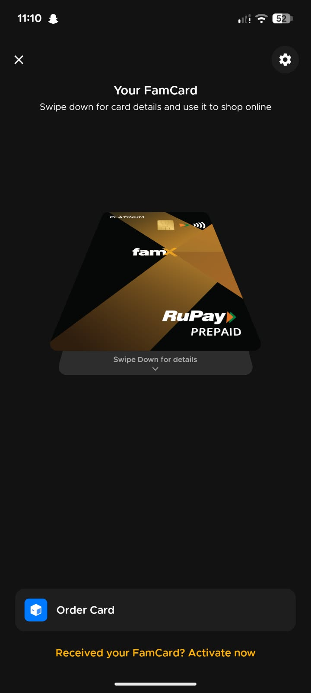
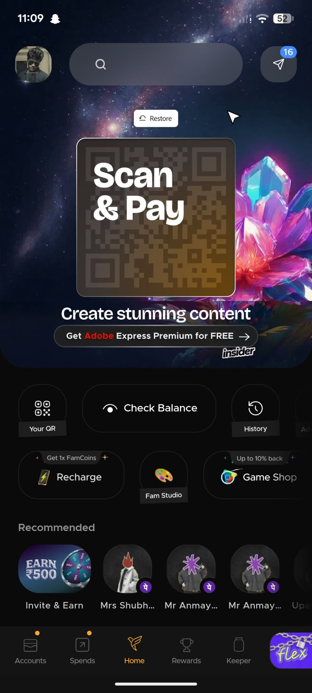

<div align="center">


# 🛡️ NEXUS PAY & FRAUD DETECTION FRAMEWORK
### *Next-Gen Smart Fraud Detection Client & Dual-Engine Predictive AI*
*Empowered by Supervised Random Forest Classifiers, Zero-Day Isolation Forest Anomalies & Real-Time Mobile Interception*

[](https://developer.android.com/jetpack/compose)
[](https://kotlinlang.org)
[](https://scikit-learn.org)
[](https://python.org)
[](https://github.com/Shiva-Try2Hack/Smart-Fraud-Detection-Framework-for-Digital-Banking-Using-Predictive-Modelling-/releases)
[](LICENSE.txt)

<br/>

**Production-grade, ultra-low-latency digital banking mobile client application paired with pre-trained AI predictive models for testing real-time transaction surveillance.**

[📥 **Download Latest Android APK (.apk)**](https://github.com/Shiva-Try2Hack/Smart-Fraud-Detection-Framework-for-Digital-Banking-Using-Predictive-Modelling-/releases) | [📋 **View Detailed Changelog**](CHANGELOG.md)

<br/>


</div>

<br/>

---

## 📌 1. Project Overview & Architecture

Modern digital banking processes billions of retail transactions every day across mobile wallets, card networks, and Unified Payments Interfaces (UPI). However, rapid transactions create immense vulnerabilities: authorized push payment scams, sudden balance-draining velocities, account takeovers, and organized mule accounts.

**NEXUS Pay** demonstrates an end-to-end modern digital banking ecosystem:
1. **The Mobile Application (`app/`)**: A fluid, modern Android banking app built with **Jetpack Compose**, featuring Apple Liquid Glass styling, 3D EMV virtual cards, biometric and PIN protection, NFC tap-to-pay, and QR code scanning.
2. **The Predictive ML Model (`src/models/fraud_model.pkl`)**: An open, production-trained dual-engine artificial intelligence model capable of scoring financial transactions in **under 15 milliseconds**.
3. **Managed Cloud Guard Gateway**: Evaluates transactions in real time against the predictive model to approve, flag, or intercept malicious payments before funds leave an account.

> [!NOTE]
> **Zero Infrastructure Overhead for Testers:** The mobile app connects automatically to our secure cloud fraud scoring gateway. You can install the APK on any Android phone and immediately test transactions without configuring servers, local IPs, or port forwarding.

<br/>

---

## 📱 2. Mobile App Showcase

<div align="center">
  <table border="0">
    <tr>
      <td align="center" width="50%">
        
        <br/>
        <b>💳 Interactive 3D Card & Balance Shield</b>
      </td>
      <td align="center" width="50%">
        
        <br/>
        <b>⚡ Real-Time Payment Flow & Verification</b>
      </td>
    </tr>
  </table>
</div>

### ✨ Key Mobile Features:
- **Liquid Glass Aesthetics**: Modern frosted glass surfaces, OLED Midnight and Crisp Light themes, and smooth micro-animations.
- **Interactive 3D Virtual EMV Card**: Tap the card for a smooth 3D flip animation displaying the 16-digit embossed number, cardholder name, chip, magnetic stripe, and hidden CVV.
- **Tactile Security Gate**: Balance is masked by default (`••••••••`). Checking balances or confirming payments triggers a tactile numeric keypad verified by the security engine.
- **Contactless NFC & QR Scanner**: Hardware NFC detection for tap-to-pay token preparation alongside ML Kit powered CameraX QR code scanning.
- **Live Fraud Alert Dialogs**: Clear transaction feedback detailing exactly why a transaction was approved or why it was blocked by the AI model.

<br/>

---

## 🧠 3. Predictive Model Architecture & Working Principles

Fraud detection cannot rely solely on simple static threshold rules. NEXUS uses a **4-tier multi-layered decision pipeline**:

```
           Incoming Payment Request from Mobile App (NEXUS Pay)
                                   │
                                   ▼
   ┌───────────────────────────────────────────────────────────────┐
   │ Layer 1: Deterministic Heuristic Engine                       │
   │ • Insufficient balance inspection                             │
   │ • Blacklisted recipient / syndicate mule verification         │
   │ • Critical one-shot balance depletion check (>95% balance)    │
   └───────────────────────────────┬───────────────────────────────┘
                                   │
                                   ▼
   ┌───────────────────────────────────────────────────────────────┐
   │ Layer 2: Contextual Behavioral Feature Engineering            │
   │ • amount_to_balance_ratio: Transaction vs available liquidity│
   │ • balance_drain_velocity: Velocity of recent outgoing funds   │
   │ • sudden_depletion_flag: High-value account drain trigger     │
   └───────────────────────────────┬───────────────────────────────┘
                                   │
                                   ▼
   ┌───────────────────────────────────────────────────────────────┐
   │ Layer 3: Dual-Engine Machine Learning Inference               │
   │ 1. Supervised Random Forest Classifier                        │
   │    Trained on PaySim multivariate financial transaction data  │
   │ 2. Unsupervised Isolation Forest                              │
   │    Zero-day anomaly detection across non-linear feature space │
   └───────────────────────────────┬───────────────────────────────┘
                                   │
                                   ▼
   ┌───────────────────────────────────────────────────────────────┐
   │ Layer 4: Real-Time Risk Tiering & Explanation Codes           │
   │ • [ APPROVED ] ➔ Risk Score < 0.40  (Instant settlement)      │
   │ • [ FLAGGED  ] ➔ Risk Score 0.40 - 0.74 (Step-up challenge)   │
   │ • [ BLOCKED  ] ➔ Risk Score >= 0.75 (Critical Interception)   │
   └───────────────────────────────────────────────────────────────┘
```

### Pre-Trained Model Bundle (`src/models/fraud_model.pkl`)
The included model bundle contains:
- `classifier`: Tuned Random Forest model scoring probability of deliberate transaction fraud.
- `isolation_forest`: Unsupervised detector flagging statistically anomalous behavioral deviations.
- `feature_columns`: Canonical feature schema ensuring zero drift and strict deterministic inference.

<br/>

---

## 👥 4. Pre-Configured Test Accounts (Try It Live!)

The system includes pre-configured accounts so anyone testing the mobile app can experience both legitimate banking transactions and live fraud interceptions:

### 🎓 Legitimate User Accounts
| Full Name | Login Email | Password | Personal UPI ID | Bank PIN | Initial Balance |
| :--- | :--- | :--- | :--- | :---: | :--- |
| **Shiva** | `shiva@nexuspay.com` | `shiva123` | `shiva@okaxis` | `1234` | ₹ 80,000.00 |
| **Prasad Kadu** | `prasad@nexuspay.com` | `prasad123` | `prasad@oksbi` | `1122` | ₹ 60,000.00 |
| **Sayali Dahake** | `sayali@nexuspay.com` | `sayali123` | `sayali@okhdfc` | `2233` | ₹ 45,000.00 |
| **Minal Thakare** | `minal@nexuspay.com` | `minal123` | `minal@okicici` | `3344` | ₹ 50,000.00 |
| **Prathamesh Meshram** | `prathamesh@nexuspay.com` | `prathamesh123` | `prathamesh@okpaytm` | `4455` | ₹ 55,000.00 |

*You can also tap **"Register Now"** inside the app to register your own custom test account.*

### ⚠️ Simulated Blacklisted Syndicate & Mule Accounts
Attempting to send funds to these addresses tests the framework's interception engine:
| Entity / Flagged Name | Flagged UPI ID | Threat Classification | Interception Outcome |
| :--- | :--- | :--- | :--- |
| **Dark Mule Node 01** | `evil.darkmule@darkpay` | Blacklisted Mule Node | **BLOCKED (Blacklist Rule)** |
| **Syndicate Phisher X** | `evil.phisher@shadowbank` | Phishing Syndicate Node | **BLOCKED (Blacklist Rule)** |
| **Launderer Ghost Hub** | `evil.launderer@ghostupi` | Money Laundering Target | **BLOCKED (Blacklist Rule)** |

### 🧪 Additional Fraud Scenarios to Test:
1. **Sudden Account Depletion**: Log in as `sayali` (Balance: ₹ 45,000) and try to transfer `₹ 44,999` in a single payment. The contextual engine and Random Forest classifier flag the sudden 99.9% liquidity drain and block the attempt.
2. **Normal Retail Transfer**: Transfer ₹ 500 from `shiva` to `prasad`. The transaction is approved in under 15ms and balances update immediately.

<br/>

---

## 🚀 5. How to Get & Run the App

### Option A: Install Pre-Built APK (Fastest)
1. Head over to the [GitHub Releases](https://github.com/Shiva-Try2Hack/Smart-Fraud-Detection-Framework-for-Digital-Banking-Using-Predictive-Modelling-/releases) page.
2. Download `app-debug.apk`.
3. Open and install on your Android device (Android 7.0+ / API 24+ supported).
4. Launch **NEXUS PAY**, log in with any test account above, and test payments!

### Option B: Build from Source in Android Studio
1. Clone this repository:
   ```bash
   git clone https://github.com/Shiva-Try2Hack/Smart-Fraud-Detection-Framework-for-Digital-Banking-Using-Predictive-Modelling-.git
   ```
2. Launch **Android Studio** (Ladybug / Koala or newer recommended).
3. Select **Open** and choose the `app/` directory from the repository.
4. Allow Gradle to synchronize dependencies.
5. Click **Run** (`Shift + F10`) or navigate to **Build ➔ Build Bundle(s) / APK(s) ➔ Build APK(s)**.

<br/>

---

## ⚙️ 6. Automated GitHub CI/CD Pipeline

This repository includes a native GitHub Actions workflow in [`.github/workflows/build_android_apk.yml`](.github/workflows/build_android_apk.yml):
- **Continuous Integration**: Builds and tests the Android app on every push to `main` and on pull requests.
- **Automated Releases**: Automatically generates and attaches the compiled `app-debug.apk` whenever a new semantic version tag (e.g. `v2.4.0`) is pushed to the repository.

<br/>

---

## 🤝 7. Project Leadership & Contributions

### 🏆 Project Creator & Lead Architecture
- **[antigravity](#)** — Core System Architecture, Mobile Engineering, UI/UX Design System & Dual-Engine AI Integration.

### 👥 Contributors & Core Team
- **[dahakesayali2](https://github.com/dahakesayali2)** — Predictive Modeling Research, Dataset Evaluation & Feature Engineering.
- **[Shiva-Try2Hack](https://github.com/Shiva-Try2Hack)** — Repository Owner, Backend Pipeline Conception & Security Protocols.
- **Prasad Kadu** — Integration Testing, Validation & Packaging.

<br/>

---

## 📄 8. License & Security Notice

This project is licensed under the terms of the [MIT License](LICENSE.txt).

> [!CAUTION]
> **Security Notice**: This repository contains the public Android mobile client and pre-trained machine learning model weights for educational, testing, and evaluation purposes. All server-side administrative tools, private execution daemons, and database state ledgers are protected and hosted privately to prevent exposure of sensitive infrastructure.
