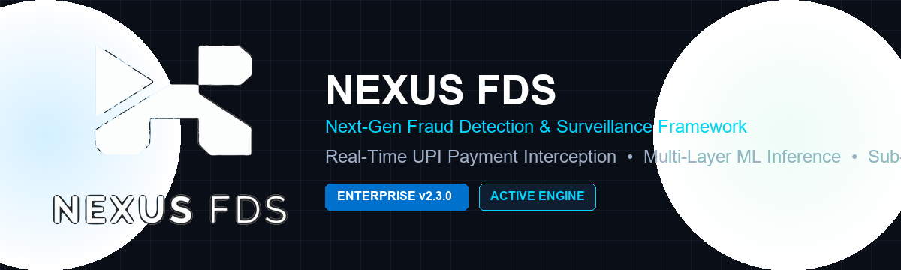

<div align="center">



# 🛡️ NEXUS FDS
### *Next-Gen Smart Fraud Detection Framework for Digital Banking*
*Powered by Multi-Layered Predictive Modelling, Zero-Day Anomaly Detection & Real-Time UPI Interception*

[](https://fastapi.tiangolo.com)
[](https://scikit-learn.org)
[](https://python.org)
[](https://github.com/Shiva-Try2Hack/Smart-Fraud-Detection-Framework-for-Digital-Banking-Using-Predictive-Modelling-/releases/tag/v2.3.0)
[](LICENSE)

<br/>

**Production-ready, ultra-low-latency digital banking fraud interception suite with dual-engine machine learning and real-time transaction surveillance.**

[📥 **Download Windows Installer v2.3.0 (.msi)**](https://github.com/Shiva-Try2Hack/Smart-Fraud-Detection-Framework-for-Digital-Banking-Using-Predictive-Modelling-/releases/tag/v2.3.0) | [📦 **View v2.3.0 Release Notes & Changelog**](https://github.com/Shiva-Try2Hack/Smart-Fraud-Detection-Framework-for-Digital-Banking-Using-Predictive-Modelling-/releases/tag/v2.3.0)

<br/>


</div>

<br/>

---

## 📌 1. Project Overview & Problem Statement

Modern banking and digital finance process billions of retail transactions daily across digital wallets, card networks, and Unified Payments Interfaces (UPI). While cashless platforms offer instant convenience, they have introduced major security vulnerabilities, including authorized push payment scams, account takeovers, and syndicate mule money transfers.

Legacy transaction inspection systems rely on static threshold rules (e.g., flagging transactions exceeding a fixed fiat cap). These legacy mechanisms exhibit critical limitations:
- They **cannot evaluate non-linear relationships** across multivariate features (amount-to-balance ratio, sudden depletion velocity, transfer anomalies).
- They generate **excessive false positives**, disrupting legitimate transactions.
- Standalone ML models kept in Jupyter notebooks lack **functional software testing workflows and native runtime environments** for end-user client applications.

### 💡 The Solution: NEXUS FDS
**NEXUS FDS** delivers a production-grade, zero-cost, CPU-optimized **Backend Inference Server & Real-time Fraud Scoring Framework**. It combines deterministic heuristic rules, contextual behavioral engines, supervised ensemble classifiers, and unsupervised anomaly detection to evaluate transactions in **under 15 milliseconds**.

<br/>

---

## 🧠 2. Multi-Layer Detection Architecture

Fraud is never evaluated through a single mechanism. NEXUS FDS employs a 4-tier decision pipeline:

```
  Incoming Payment Payload (From Mock UPI App / Mobile Client)
                             │
                             ▼
 ┌───────────────────────────────────────────────────────────────┐
 │ Layer 1: Deterministic Heuristic Rule Engine                  │
 │ • Insufficient balance check                                  │
 │ • Blacklisted recipient / syndicate mule check                │
 │ • Extreme one-shot depletion (>95% total balance)             │
 └───────────────────────────┬───────────────────────────────────┘
                             ▼
 ┌───────────────────────────────────────────────────────────────┐
 │ Layer 2: Contextual Behavioral Feature Engine                 │
 │ • amount_to_balance_ratio                                     │
 │ • balance_drain_velocity                                      │
 │ • sudden_depletion_flag                                       │
 └───────────────────────────┬───────────────────────────────────┘
                             ▼
 ┌───────────────────────────────────────────────────────────────┐
 │ Layer 3: Dual-Engine Machine Learning Inference               │
 │ • Supervised Random Forest Classifier (Trained on PaySim dist)│
 │ • Unsupervised Isolation Forest (Zero-Day Anomaly Detection)  │
 └───────────────────────────┬───────────────────────────────────┘
                             ▼
 ┌───────────────────────────────────────────────────────────────┐
 │ Layer 4: Risk Tiering & Explanation Codes                     │
 │ • [ APPROVED ] -> Risk Score < 0.40  (Balances Updated)       │
 │ • [ FLAGGED  ] -> Risk Score 0.40 - 0.74 (Step-up Verification│
 │ • [ BLOCKED  ] -> Risk Score >= 0.75 (Critical Interception)  │
 └───────────────────────────────────────────────────────────────┘
```

<br/>

---

## ⚡ 3. Key Technical Highlights

- **Native Windows Desktop Installer (.MSI)**: Clean installer wizard equipped with customized welcome dialog, banner artwork, license agreement, path selection, and dedicated desktop & start menu shortcuts.
- **Embedded Tkinter Server Controller**: Integrated management GUI with live request feed, transaction surveillance alerts, AppUserModelID taskbar integration, and admin terminal.
- **Dedicated Uninstaller**: Packaged with `uninstall.bat` and standard Windows MSI uninstallation support.
- **Zero PyArrow Overhead**: Inference pipeline optimized with direct NumPy feature vectors for maximum speed and compatibility.
- **Sub-15ms Latency**: Real-time evaluation pipeline responding in under 15 milliseconds.
- **Stateful Account Ledger**: Embedded SQLite persistence tracks live balances for legitimate users and flagged mule nodes.

<br/>

---

## 👥 4. Pre-Configured Test Accounts

The database comes pre-seeded with 5 legitimate student accounts and 3 dummy syndicate evil nodes for live fraud testing:

### 🎓 Legitimate Users
| Username | Full Name | Personal UPI ID | PIN | Default Balance |
| :--- | :--- | :--- | :---: | :--- |
| `shiva` | Shiva | `shiva@okaxis` | `1234` | ₹ 80,000.00 |
| `prasad` | Prasad Kadu | `prasad@oksbi` | `1122` | ₹ 60,000.00 |
| `sayali` | Sayali Dahake | `sayali@okhdfc` | `2233` | ₹ 45,000.00 |
| `minal` | Minal Thakare | `minal@okicici` | `3344` | ₹ 50,000.00 |
| `prathamesh`| Prathamesh Meshram | `prathamesh@okpaytm` | `4455` | ₹ 55,000.00 |

### ⚠️ Flagged Evil / Mule Accounts
| Username | Entity Name | Flagged UPI ID | PIN | Status |
| :--- | :--- | :--- | :---: | :--- |
| `evil_darkmule` | Dark Mule Node 01 | `evil.darkmule@darkpay` | `0000` | Blacklisted Mule |
| `evil_phisher` | Syndicate Phisher X | `evil.phisher@shadowbank` | `0000` | Phishing Node |
| `evil_launderer`| Launderer Ghost Hub | `evil.launderer@ghostupi` | `0000` | Laundering Hub |

*Sending money to any `[EVIL]` account automatically triggers a blacklist block.*

<br/>

---

## 🚀 5. Getting Started & Setup

### Option A: Install via Windows Installer (.MSI)
1. Download **`Nexus FDS Server-2.3.0-win64.msi`** from the [Latest Release](https://github.com/Shiva-Try2Hack/Smart-Fraud-Detection-Framework-for-Digital-Banking-Using-Predictive-Modelling-/releases/tag/v2.3.0).
2. Run the installer wizard, review the license agreement, select your preferred installation directory, and install.
3. Launch **NEXUS FDS Server** directly from your Desktop or Start Menu.

### Option B: Run from Source
```bash
# Clone the repository
git clone https://github.com/Shiva-Try2Hack/Smart-Fraud-Detection-Framework-for-Digital-Banking-Using-Predictive-Modelling-.git
cd Smart-Fraud-Detection-Framework-for-Digital-Banking-Using-Predictive-Modelling-

# Install dependencies
pip install -r requirements.txt

# Launch NEXUS FDS Controller GUI
python server_ui.py
```

<br/>

---

## 🖥️ 6. Graphical Server Controller & Surveillance Dashboard

Launch the unified desktop management application:
```bash
python server_ui.py
```

### 🔐 1. Admin Security Gate
Access to the server controller is protected by an administrative security gate (`admin` / `admin123` by default, customizable via environment variables).

### 🛡️ 2. Live Server Controller & Admin Terminal
- **Server Process Control**: One-click **Start Server** and **Stop Server** with live status indicators.
- **Real-Time Surveillance**: Streams all backend HTTP requests and real-time transaction risk scoring (`APPROVED`, `FLAGGED`, `BLOCKED`).
- **Interactive Admin Console**: Execute commands like `pay`, `bal <upi_id>`, `list`, or `stats` directly within the GUI.

<br/>

---

## 📡 7. API Reference

### `POST /api/payment/process`
Evaluates and scores a live payment attempt.

**Request Body:**
```json
{
  "sender_id": "shiva@okaxis",
  "receiver_id": "prasad@oksbi",
  "transaction_type": "TRANSFER",
  "amount": 2500.0,
  "pin": "1234"
}
```

**Response (`APPROVED`):**
```json
{
  "transaction_id": "TXN_7B894F1C02",
  "sender_id": "shiva@okaxis",
  "receiver_id": "prasad@oksbi",
  "amount": 2500.0,
  "status": "APPROVED",
  "risk_score": 0.0,
  "risk_level": "LOW",
  "supervised_ml_prob": 0.0,
  "anomaly_detected": false,
  "reasons": ["Transaction verified and safe"],
  "sender_new_balance": 77500.0,
  "timestamp": "2026-10-18T02:00:00.000Z"
}
```

<br/>

---

## 🛠️ 8. Troubleshooting & Issue Resolution

### Issue #1: Resolving MSI Installation / Uninstallation Permission Errors (Error: 5)
If you encounter:
> `Could not set file security for file 'D:\Config.Msi\*.rbf. Error: 5. Verify that you have sufficient privileges to modify the security permissions for this file.`

#### Causes & Fixes:
1. **Elevate Uninstallation**:
   Run Command Prompt as **Administrator**:
   ```cmd
   msiexec /x "Nexus FDS Server-2.3.0-win64.msi" /quiet /l*v uninstall.log
   ```
2. **Dedicated Uninstaller**:
   In the installation directory, run `uninstall.bat` as Administrator.
3. **Clean Orphaned Rollback Cache**:
   If `Config.Msi` on your drive remains locked:
   ```cmd
   takeown /F "D:\Config.Msi" /R /D Y
   icacls "D:\Config.Msi" /grant administrators:F /T
   ```
4. **Kill Running Server Instances**:
   Ensure no active background processes hold locks before uninstalling:
   ```cmd
   taskkill /F /IM "Nexus FDS Server.exe" /T
   ```

---

## 📄 License
This project is licensed under the MIT License.

<br/>

<div align="center">
  <b>NEXUS FDS • Built for secure, reliable, and intelligent digital banking ecosystems.</b>
</div>
